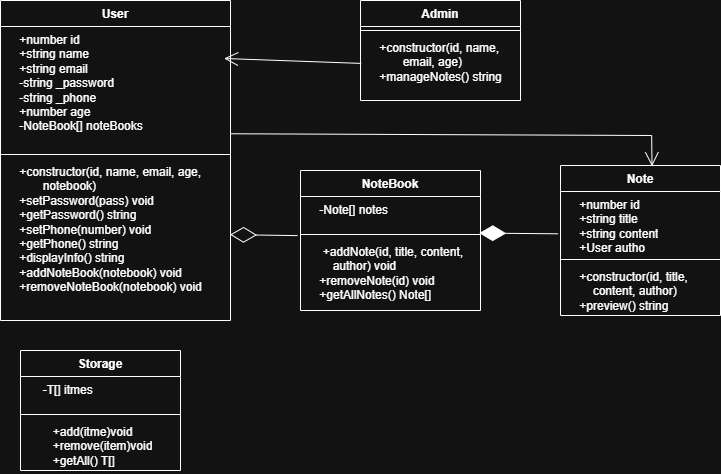
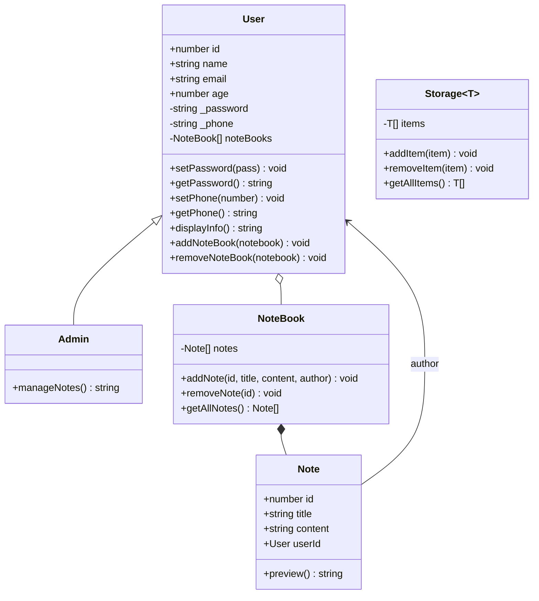

# 📝 TypeScript OOP Notes App

A small, focused TypeScript project that models a **notes application** using core object-oriented programming concepts: classes, inheritance, encapsulation, composition/aggregation, and generics.

It is built as a learning project: the goal is clear, readable OOP design with strict TypeScript, not a full-featured app.



---

## ✨ OOP Concepts Demonstrated

| Concept | Where it appears |
| --- | --- |
| **Encapsulation** | `User` keeps `_password`, `_phone` and `noteBooks` `private`, exposed through getters/setters and methods. `NoteBook` hides its `notes` array and returns a copy from `getAllNotes()`. |
| **Inheritance** | `Admin` extends `User` and adds `manageNotes()`. |
| **Composition** | A `NoteBook` is made of `Note`s (filled-diamond relationship in the UML). |
| **Aggregation** | A `User` owns a collection of `NoteBook`s (hollow-diamond relationship in the UML). |
| **Generics** | `Storage<T>` is a reusable, type-safe container for any item type. |
| **Parameter properties** | Constructors use `public id: number` style shorthand to declare and assign fields in one place. |
| **Validation** | `User` throws if `age` is outside **18–60**. |

---

## 🧱 Class Overview



### `Note`
A single note with an `id`, `title`, `content`, and its author. `preview()` returns a formatted string of the content.

### `NoteBook`
A private list of notes with three operations:
- `addNote(id, title, content, author)` creates a `Note` and stores it.
- `removeNote(id)` removes the note with a matching id.
- `getAllNotes()` returns a **copy** of the notes so callers can't mutate internal state.

### `User`
Holds profile data (`id`, `name`, `email`, `age`), private credentials (`password`, `phone`), and the user's notebooks.
- Throws `Error("Age must be between 18 and 60.")` for invalid ages.
- `displayInfo()` returns a formatted profile string (password is intentionally **not** included).
- `addNoteBook()` / `removeNoteBook()` manage the user's notebooks.

### `Admin`
Extends `User` and adds `manageNotes()`.

### `Storage<T>`
A generic container with `addItem`, `removeItem` and `getAllItems`, usable with any type, e.g. `Storage<Note>` or `Storage<User>`.

---

## 🚀 Getting Started

### Prerequisites
- [Node.js](https://nodejs.org/) (a current LTS release is recommended)
- npm

### Install

```bash
git clone https://github.com/Eslam-Alaa-ElDeen/typescript-oop-notes-app.git
cd typescript-oop-notes-app
npm install
```

### Run in development

The project compiles TypeScript from `src/` into `dist/`, then runs the output with `nodemon`.

```bash
npm run start:conc
```

This starts two processes together via `concurrently`:
1. `tsc --watch` recompiles `src/` on every change.
2. `nodemon dist/index.js` restarts the app whenever the compiled output changes.

### Scripts

| Script | What it does |
| --- | --- |
| `npm run start:conc` | Watch-compile TypeScript **and** auto-restart the app (recommended for development). |
| `npm start` | Run `dist/index.js` under `nodemon` (requires an existing build). |

To compile once without watching:

```bash
npx tsc
```

---

## 💡 Example Usage

`src/index.ts` currently declares the classes without exporting them. To try them out, add this to the bottom of `src/index.ts`:

```ts
const alice = new User(1, "Alice", "alice@example.com", 30);
alice.setPhone("555-0100");
alice.setPassword("s3cret");

const work = new NoteBook();
work.addNote(1, "Standup", "Discuss the release plan", alice);
work.addNote(2, "Ideas", "Try generics for storage", alice);
alice.addNoteBook(work);

console.log(alice.displayInfo());
console.log(work.getAllNotes().map(n => n.preview()));

work.removeNote(1);
console.log(work.getAllNotes().length); // 1

const admin = new Admin(2, "Bob", "bob@example.com", 40);
console.log(admin.manageNotes()); // "Admin manage the notes"

const store = new Storage<string>();
store.addItem("hello");
console.log(store.getAllItems()); // ["hello"]

// Validation
try {
  new User(3, "Kid", "kid@example.com", 12);
} catch (e) {
  console.error((e as Error).message); // "Age must be between 18 and 60."
}
```

---

## 🗂️ Project Structure

```
typescript-oop-notes-app/
├── src/
│   └── index.ts          # All classes: Note, NoteBook, User, Admin, Storage<T>
├── dist/                 # Compiled JS output (git-ignored)
├── UML_ROUTE_OOP.png     # UML class diagram
├── tsconfig.json         # Strict TypeScript configuration
├── package.json          # Scripts and dev dependencies
└── .gitignore
```

---

## ⚙️ TypeScript Configuration

The project uses a strict setup (see `tsconfig.json`):

- `strict`, `noUncheckedIndexedAccess`, `exactOptionalPropertyTypes`, `noUnusedParameters`
- ES module output (`"module": "nodenext"`, `"type": "module"` in `package.json`)
- `target: esnext`, `verbatimModuleSyntax`, `isolatedModules`
- Source in `src/`, output in `dist/`

---

## 🛠️ Tech Stack

- **TypeScript**: language and strict type checking
- **Node.js**: runtime
- **nodemon**: auto-restart on changes
- **concurrently**: run the compiler and the app side by side

---

## 🧭 Ideas for Next Steps

- Export the classes and split them into one file per class
- Add a demo/entry script and unit tests (e.g. Vitest or Jest)
- Hash passwords instead of storing plain text
- Make `Note.userId` an actual id (or rename it to `author`), since it currently holds a `User`
- Persist notes to JSON or a database
- Use `Storage<T>` inside `NoteBook` and `User` to remove duplicated list logic
- Add `update` and `search` operations for notes

---

## 👤 Author

**Eslam Alaa ElDeen**: [GitHub](https://github.com/Eslam-Alaa-ElDeen)

## 📄 License

Released under the ISC License.
